# SharP

**One home for physics, with a tutor that sees what you see.**

SharP is a free, community-driven platform that brings interactive physics simulations, an AI tutor named Psi, and the physics community together in one place. Psi is aware of the experiment a learner has open, explains it from a textbook knowledge base, and proposes the next experiment as a single click. The community proposes and votes on what is built next.

This repository is our submission to AI Showdown, the 4th International AI Championship (AIEF), in the category AI in Education.

## Read the proposal

1. [Problem Statement](01_Problem_Statement.md)
2. [Our Solution](02_Our_Solution.md)
3. [Platform Overview](03_Platform_Overview.md)
4. [Project Plan](04_Project_Plan.md)

## See it working

### The platform

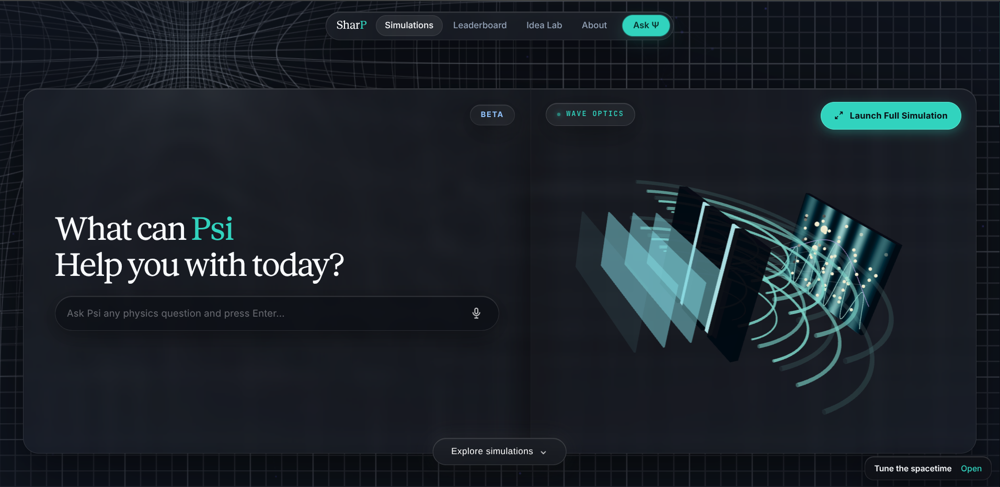

**The home page.** A live showcase, the catalogue, and Psi available from the first moment.

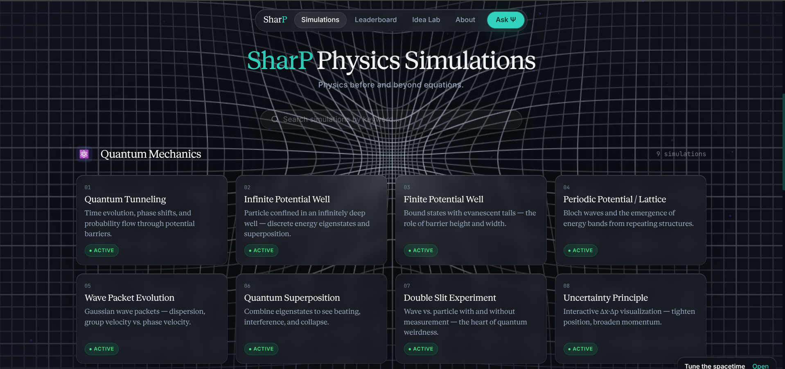

**The simulation library.** Simulations are grouped by area of physics and can be found by keyword.

### Psi, the AI tutor

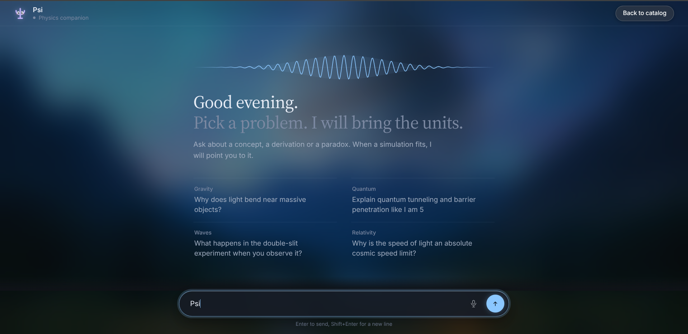

**Ask Psi anything.** A learner can bring Psi a concept, a derivation or a paradox before opening any simulation.

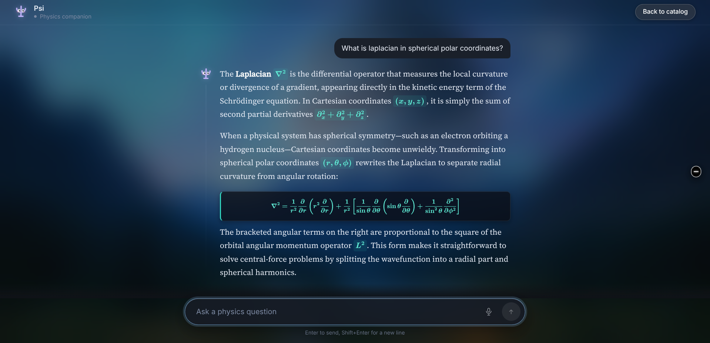

**Grounded, typeset answers.** Psi explains with properly rendered mathematics.

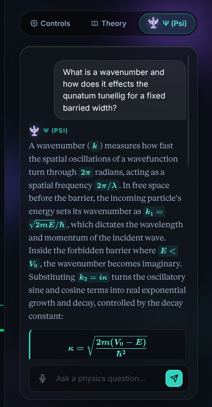

**Psi inside a simulation.** The tutor sits beside the experiment, in the same panel as the controls and the theory.

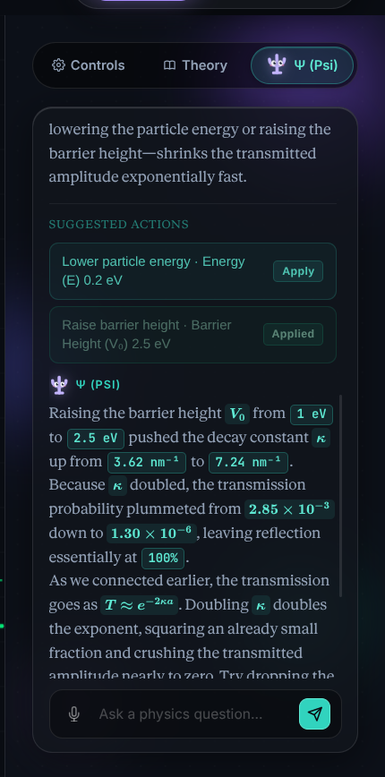

**A one-click experiment.** Psi proposes the next thing to try. One click moves the simulation, and Psi then explains what changed, using the numbers on screen. This view is from our latest build.

### Simulations

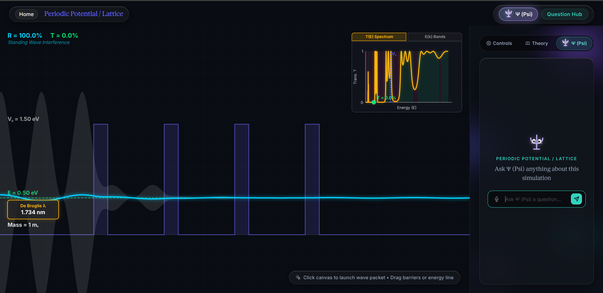

**Periodic potential and lattice.** Transmission through a lattice of barriers, with the energy bands that emerge from it.

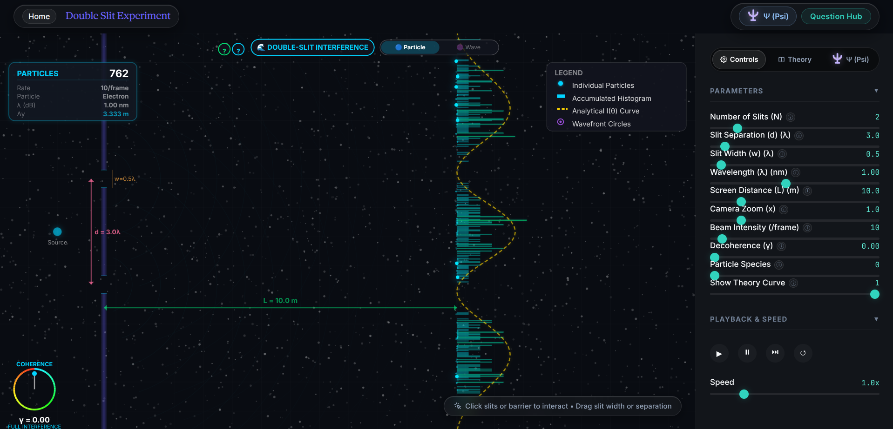

**Double slit experiment.** Particles build up an interference pattern, with the theory curve alongside.

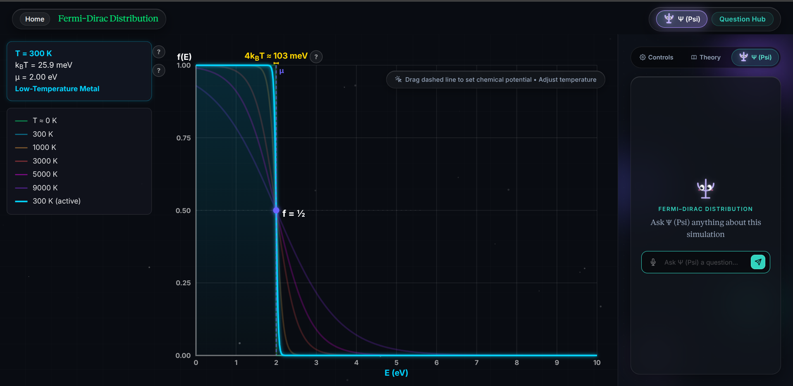

**Fermi-Dirac distribution.** How temperature smears the occupation of energy levels.

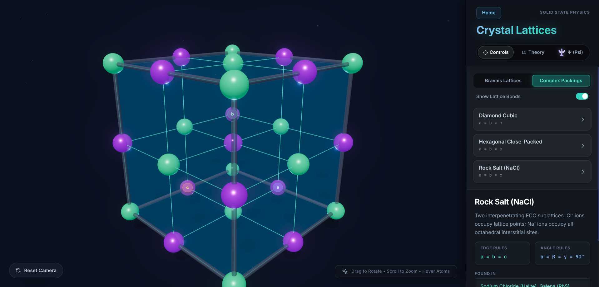

**Crystal lattices, rock salt.** A three-dimensional structure the learner can rotate, zoom and inspect.

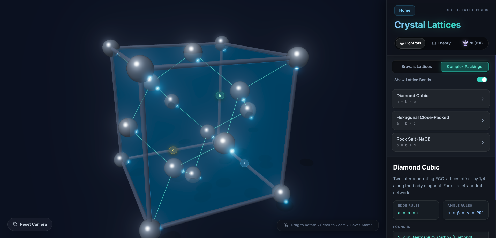

**Crystal lattices, diamond cubic.** Each structure comes with its geometry rules and the materials that use it.

### The community

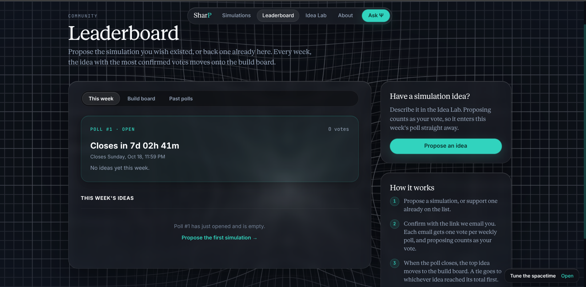

**The Idea Lab.** Learners describe the simulation they wish existed.

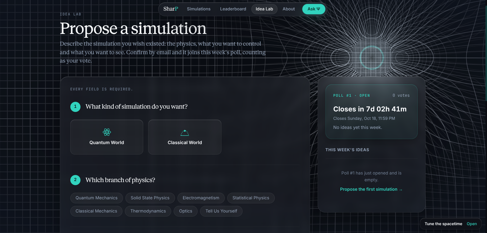

**The weekly poll and build board.** The community votes on what is built next.

## Team

- **Muhammad Haris**, frontend development and integration
- **Muhammad Abdullah**, simulation development and user experience
- **Hasan Ali**, backend development, security and quality
